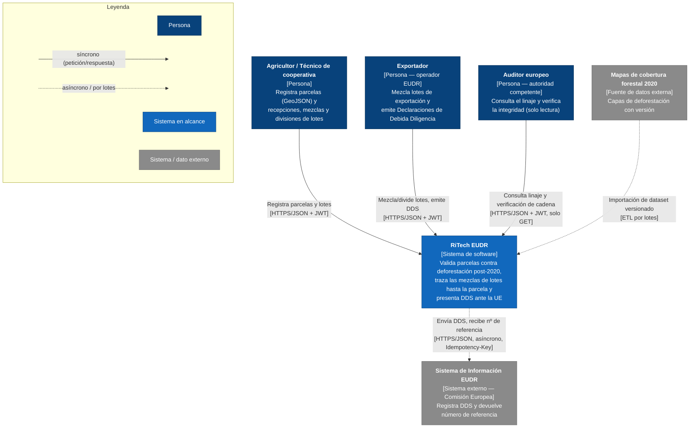
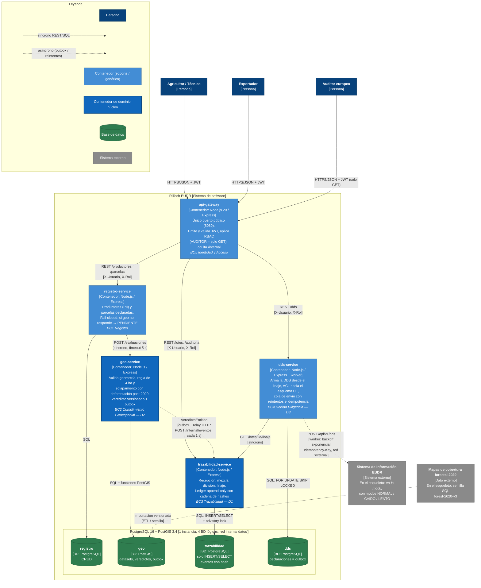

# RiTech EUDR — Documentación de Arquitectura

## Parte 3: Diagramas C4 (Nivel 1 y Nivel 2)

Los diagramas usan `flowchart` de Mermaid en lugar de la sintaxis experimental `C4Context`. Así se pueden dibujar **leyendas** y distinguir flechas síncronas de asíncronas, cosa que la sintaxis C4 de Mermaid no permite. La notación sigue C4: Persona, Sistema, Contenedor y Base de datos, cada uno con el formato `[Tipo: Tecnología]`.

Versiones ya renderizadas (mermaid-cli 11.4.2): [Nivel 1](img/c4-nivel1-contexto.svg) · [Nivel 2](img/c4-nivel2-contenedores.svg).

---

## Nivel 1 — Diagrama de Contexto

**Decisiones del Paso 2 visibles en el Nivel 1:**
- La relación con la UE es **asíncrona** (ADR-003, D3).
- El auditor tiene acceso de **solo lectura** (T15).
- Los mapas forestales entran como **dataset con versión**, no como consulta en línea, para que los veredictos sean deterministas (T7, D2).

---

## Nivel 2 — Diagrama de Contenedores

### Redes Docker (táctica T14; no caben en el diagrama sin saturarlo)

| Red | Miembros | Propósito |
|---|---|---|
| `servicios` | gateway, registro, geo, trazabilidad, dds, demo | Tráfico REST entre servicios |
| `datos` (`internal: true`) | postgres, registro, geo, trazabilidad, dds, demo* | Sin salida al exterior; el gateway **no** está en ella |
| `externa` | dds-service, eu-is-mock, demo* | Solo `dds-service` puede hablar con la "UE" |

\* `demo` está en `datos` solo para **simular un ataque** de manipulación del ledger (ver README).

### Cómo se reflejan las decisiones del Paso 2

| Decisión | Dónde se ve en el Nivel 2 |
|---|---|
| ADR-001 un servicio por BC + BD por servicio | 4 contenedores de dominio, cada uno con su propio cilindro de BD |
| ADR-001 consecuencia negativa: instancia única | Las 4 BD comparten la caja "1 instancia" |
| ADR-002 ledger append-only | `trazabilidad` → "solo INSERT/SELECT + advisory lock" |
| ADR-003 asincronía con la UE | Flecha punteada dds → UE con backoff + Idempotency-Key |
| Consistencia eventual BC2 → BC3 | Flecha punteada "outbox + relay" |
| D2 síncrono para respuesta inmediata | Flecha continua registro → geo |
